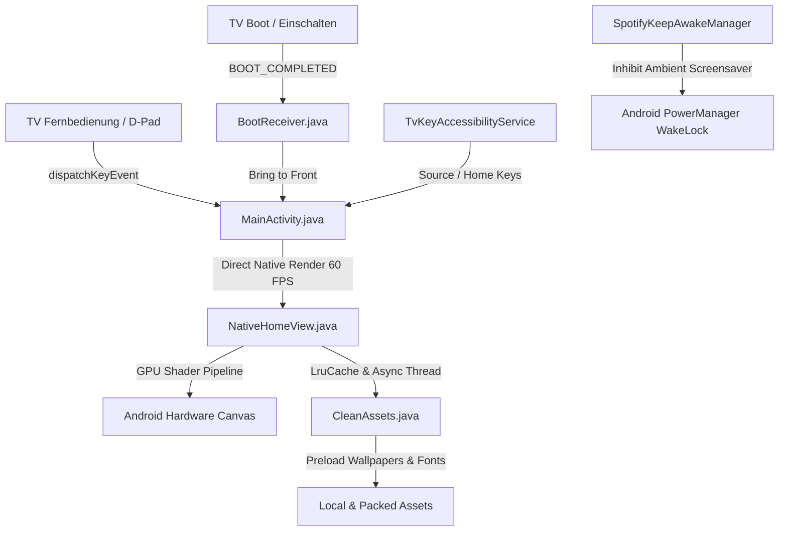

# CleanScreen Home for Android TV & Google TV

<p align="center">
  <b>Ein ruhiger, ablenkungsfreier und hochperformanter 100% nativer Android-Launcher im Samsung The Frame-Stil — mit Art-Mode-Galerie, Apple Liquid Glass-Dock, D-Pad-Navigation und vollständiger visueller Anpassung.</b>
</p>

<p align="center">
  
  
  
  
  
</p>

---

## 🌟 Übersicht / Overview

**CleanScreen Home** ist ein minimalistischer, schneller und eleganter Home-Launcher für Android TV- und Google TV-Geräte (z. B. Xiaomi Mi TV, Chromecast mit Google TV, Sony Bravia, Nvidia Shield, TCL).

Ursprünglich inspiriert von Nathan Clarks *CleanFrame* für Samsung The Frame, wurde diese Version von Grund auf als **100% native Android-App** (ohne WebView) neu entwickelt. Sie bietet maximale Reaktionsgeschwindigkeit, butterweiche 60-FPS-Navigation auf Android TV 9+ und tiefgehende Anpassungsmöglichkeiten.

> **Branches:**
> - **`main`**: Die moderne, 100% native Android-Version (höchste Performance, 60 FPS, Apple Liquid Glass, vollständige Live-Regler).
> - **`webview`**: Die vorherige HTML5/WebView-Version (als Archiv gesichert).

---

## 🚀 Hauptfunktionen / Key Features

### 1. 100% Native Performance & Hardware-Beschleunigung
- **Keine WebView-Lags:** Vollständig native Android `Canvas`- und GPU-Pipeline.
- **Asynchrones Bild- und Textur-Caching:** Non-blocking `LruCache` für Wallpapers, Schriftarten und Texturen – keine Ruckler beim Karussell-Start.
- **Anti-Aliasing ohne Kantenflimmern:** Verwendet moderne `BitmapShader` anstelle von unsauberen `clipPath`-Operationen für makellos abgerundete Ecken.

### 2. Apple Liquid Glass & Dock-Stile
- **Apple Glas mit 3D-Wölbung:** Echte optische Linsenbrechung (`applyMaterialLensMatrix`), 3D-Glaskuppel-Glanz und duale Fresnel-Spiegelkanten.
- **Klassisches Frosted Glass:** Sanfte, matte Milchglas-Optik mit konfigurierbarer Trübung (*Frost*, *Weichzeichner*, *Klares Glas*).
- **Fokus-Vergrößerung:** Ausgewählte Apps vergrößern sich beim Navigieren butterweich und heben sich dezent ab.
- **Minimal-Modus:** Type-Stil ohne Dock-Container für maximale Bildfokussierung.

### 3. Vollständige Live-Layout-Steuerung
- **Stufenlose Schieberegler mit Sofort-Vorschau:**
  - **Horizontale Position X** (`0%` bis `100%`, zentriert auf `50%`)
  - **Vertikale Position Y** (`10%` bis `98%`, Standard `85%`)
  - **Dock- & Kachel-Größe** (`50%` bis `140%`)
  - **Icon-Größe im Karussell** (`50%` bis `150%`)
- **App-Beschriftung:** Wählbar zwischen *Nur Icons*, *Icons & Text* oder *Nur Text*.
- **Freistehende Beschriftung bei „Nur Icons“:** Name der aktiven App ohne störende Hintergrundform – wahlweise frei positionierbar **Unten (unter Dock)** oder **Oben (über Dock)**.

### 4. Frei anpassbare Uhrzeit & Kunstwerk-Anzeige
- **Position:** *Oben links*, *Oben Mitte*, *Mitte (Groß)*, *Unten links*, *Unten rechts* oder *Aus*.
- **Größe:** Stufenlos per Schieberegler von `50%` bis `250%`.
- **Schriftarten:** *Manrope* (Modern), *Geist* (Clean Tech), *Newsreader* (Serif), *Digital* (Monospace), *Thin* (Ultra-Light).
- **Schriftstile:** *Normal*, *Fett*, *Kursiv*, *Fett & Kursiv*, *Kontur (Outline)*.
- **Glas-Kapsel:** Freistehend oder eingefasst in eine *Apple Liquid Glass-* bzw. *Frosted Glass-* Kapsel.
- **Kunstwerk-Titel:** Anzeige des aktuellen Bildnamens neben oder unter der Uhrzeit ein-/ausschaltbar.

### 5. Fullscreen Art Mode Screensaver
- Verwandelt den Fernseher in ein echtes Kunstwerk an der Wand.
- **100% UI-frei:** Alle Docks, Buttons und Texte werden im Art Mode ausgeblendet.
- **Manuelles Blättern:** Mit **◄ Links / Rechts ►** auf der Fernbedienung durch kuratierte Kunstwerke stöbern.
- **Automatischer Ruhezustand:** Wechselt nach 3 Minuten Inaktivität auf dem Homescreen automatisch in den Art Mode.

### 6. Autostart & Intelligente Launcher-Verwaltung
- **Keine störenden Channels beim TV-Neustart:** Ein nativer `BootReceiver` und der integrierte Barrierefreiheitsdienst sichern den direkten Start von CleanScreen nach dem Einschalten.
- **Spotify Screensaver-Sperre:** Verhindert automatisch den Google Screensaver / Ambient Mode, solange Musik in Spotify läuft. Albumcover, Titel und Songtexte bleiben dauerhaft sichtbar. Sobald die Musik pausiert oder Spotify verlassen wird, schaltet sich der normale Screensaver zum Schutz des Displays wieder ein. In den Einstellungen unter *Launcher & System* an- und abschaltbar.
- **Dynamischer Launcher-Wechsler:** Erkennt automatisch andere installierte Launcher auf dem Gerät und ermöglicht den nahtlosen Wechsel.
- **Standard-App-Zuweisung:** CleanScreen lässt sich dauerhaft als Standard-Launcher für die Home-Taste festlegen.

### 7. App-Manager & Homescreen-Bereinigung
- **Bloatware-frei:** Keine ungenutzten Dummy-Apps mehr.
- **Einfaches Sortieren & Entfernen:**
  - Direkt auf dem Homescreen: **OK lange gedrückt halten** → **◄ / ►** zum Verschieben, **▼ Runter** zum Entfernen.
  - Im Einstellungsmenü: Übersichtliche Zwei-Spalten-Verwaltung mit dediziertem *Entfernen*-Button für jede App.
- **Arbeitsspeicher-Bereinigung:** Integrierte 1-Klick-Funktion zum Beenden von Hintergrund-Apps zur RAM-Freigabe.

---

## 🛠️ Architektur / Architecture



---

## 📦 Installation & Build

### Voraussetzungen
- Android TV oder Google TV ab **Android 9.0 (API 28)**.
- Entwickleroptionen & **USB-/Netzwerk-Debugging** auf dem Fernseher aktiviert.

### 1. Repository klonen
```bash
git clone https://github.com/LaurinEngelen/Custom-CleanFrame-AndroidTV.git
cd Custom-CleanFrame-AndroidTV
```

### 2. APK kompilieren
```bash
./gradlew assembleDebug
```
Das fertige APK liegt unter:
`app/build/outputs/apk/debug/app-debug.apk`

### 3. Auf den Fernseher übertragen & installieren
```bash
adb connect <TV-IP-ADRESSE>:5555
adb install -r app/build/outputs/apk/debug/app-debug.apk
```

### 4. Starten & Berechtigungen einrichten
```bash
adb shell pm grant com.example.tv android.permission.READ_LOGS
adb shell settings put secure enabled_accessibility_services com.example.tv/com.example.tv.TvKeyAccessibilityService
adb shell settings put secure accessibility_enabled 1
adb shell am start -n com.example.tv/.MainActivity
```

---

## 📄 Lizenz

Dieses Projekt ist unter der [MIT License](LICENSE) lizenziert.
Basiert auf dem Designkonzept von [Nathan Clark (CleanFrame)](https://github.com/nthnclrk/CleanFrame).
Fotografien bereitgestellt via Unsplash (Credits siehe `PHOTO-CREDIT.md`).
