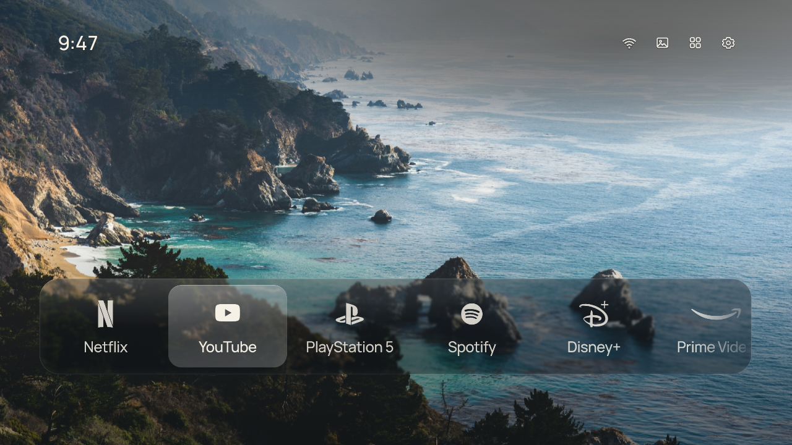
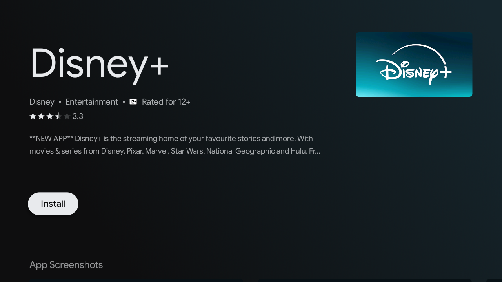
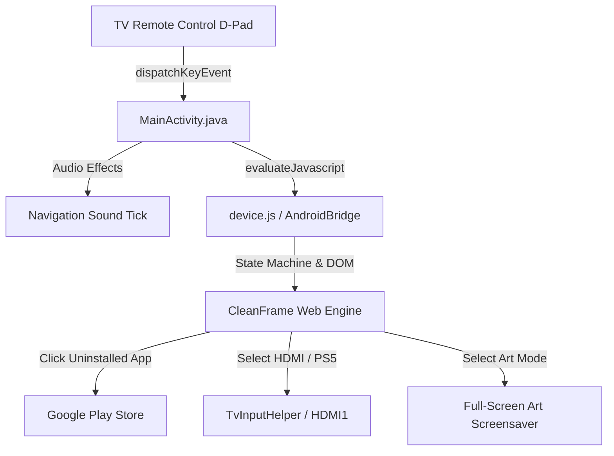

# CleanFrame for Android TV & Google TV

<p align="center">
  <b>A quiet, distraction-free home launcher inspired by Samsung The Frame — with Art Mode screensaver, remote D-Pad navigation, and DPR auto-scaling for Android TV.</b>
</p>

<p align="center">
  
  
  
  
</p>

---

## Overview

**CleanFrame Android TV** is an open-source, ultra-minimalist home launcher designed specifically for Android TV and Google TV devices (such as Xiaomi Mi TV, Chromecast with Google TV, Sony Bravia, Nvidia Shield, and TCL TVs).

Ported from [Nathan Clark's CleanFrame](https://github.com/nthnclrk/CleanFrame) (originally built for Samsung The Frame on Tizen), this project brings the same serene aesthetic, high-res photographic art gallery, and zero-distraction interface to the Android TV ecosystem.

---

## Screen Preview

| Home Screen (Wi-Fi Icon & Dock) | Fullscreen Art Mode Screensaver (Zero UI) |
| :---: | :---: |
|  |  |

| Artwork Rotation (Quiet Cove) | Direct Google Play Store Integration |
| :---: | :---: |
|  |  |

---

## Key Features

- **Quick Wi-Fi & Ethernet Network Settings**:
  - Dedicated status icon situated directly to the left of Art Mode.
  - Clicking it immediately launches the native Android TV *Network & Internet* list for fast Wi-Fi connection switching and configuration.
  - Automatically detects active network type (Wi-Fi vs Ethernet).

- **Full-Screen Art Mode Screensaver**:
  - Turns your TV into an authentic museum art piece on the wall.
  - **Zero UI**: All docks, status text, clocks, and overlays vanish into 100% pure art canvas.
  - **Interactive Remote Controls**: Press **Left** or **Right** on the TV remote to browse artworks; press any key to wake back up to the Home screen.
  - **Auto-Slideshow**: Seamlessly cycles through high-resolution curated gallery photos every 45 seconds.
  - **Auto-Idle Timer**: Automatically launches Art Mode screensaver after 3 minutes of inactivity on the Home screen.

- **Universal Display Scaling (720p / 1080p / 4K)**:
  - Engineered with real physical display geometry and `devicePixelRatio` compensation.
  - Fits 720p TVs (such as Xiaomi Mi TV 32" `tvdpi`), 1080p, and 4K UHD displays to the exact millimeter with zero cropping.

- **Live TV & HDMI 1 Switching (PlayStation 5)**:
  - Integrates with Android's `TvInputManager` (`com.droidlogic.tvinput` / passthrough service) for one-click switching to your console or cable box.

- **Smart Google Play Store Redirection**:
  - If a highlighted streaming app (Disney+, Prime Video, Stremio, Netflix, Spotify) is not yet installed, clicking its card directs straight to the official Google Play Store (`com.android.vending`) install page instead of showing an error.
  - Fixes regional package discrepancies (e.g., official global `com.disney.disneyplus`).

- **Photographic Wallpapers & Frosted Glass**:
  - 15+ bundled offline high-resolution artworks (Misty Coast, Quiet Cove, Mountain Valley, Forest Mist, Golden Peak, Alpine Horizon, etc.).
  - Pre-rendered optic glass blur and adaptive contrast ink.

- **Native Android TV Leanback Integration**:
  - Declared as `CATEGORY_LEANBACK_LAUNCHER` and `CATEGORY_HOME`.
  - Responsive remote D-Pad navigation (Up, Down, Left, Right, OK, Back) with subtle audio tick feedback.

---

## Architecture



### Bridge Methods (`AndroidBridge`)
- `launch(packageName)`: Resolves package and launches Leanback / standard intent, or redirects to Play Store.
- `openHdmi(port)`: Switches TV input to HDMI 1 via Android TV Input Framework.
- `openSettings()`: Opens native Android TV system settings.
- `openNetworkSettings()`: Opens native Android TV Network & Internet settings.
- `enterArtMode()`: Triggers full-screen art screensaver.
- `getInstalledAppsJson()`: Queries installed TV apps dynamically.

---

## Getting Started

### Prerequisites
- Android Studio Ladybug / Meerkat or Android SDK command-line tools.
- A TV running Android 9.0 (Pie) or newer with ADB debugging enabled.

### 1. Clone the Repository
```bash
git clone https://github.com/ravizikrillah/CleanFrame-AndroidTV.git
cd CleanFrame-AndroidTV
```

### 2. Build the Debug APK
```bash
./gradlew assembleDebug
```
The compiled APK will be generated at:
`app/build/outputs/apk/debug/app-debug.apk`

### 3. Install on TV via ADB
Connect to your TV over Wi-Fi or USB:
```bash
adb connect <YOUR_TV_IP>:5555
adb install -r app/build/outputs/apk/debug/app-debug.apk
```

### 4. Launch the App
```bash
adb shell am start -n com.example.tv/.MainActivity
```

---

## Setting as Default Home Launcher

1. Press the **Home** button on your TV remote.
2. Android TV will prompt you to select the default launcher.
3. Choose **CleanFrame** and select **Always**.

*(To revert at any time, go to TV Settings → Apps → Special app access → Default home app, or uninstall the APK via `adb uninstall com.example.tv`)*.

---

## Project Structure

```
CleanFrame-AndroidTV/
├── app/
│   ├── src/main/
│   │   ├── AndroidManifest.xml          # Leanback launcher declaration
│   │   ├── java/com/example/tv/
│   │   │   ├── MainActivity.java        # Core Activity & JavaScript bridge
│   │   │   └── TvInputHelper.java       # HDMI Input switching logic
│   │   ├── assets/cleanframe/
│   │   │   ├── index.html               # CleanFrame TV stage markup
│   │   │   ├── main.js                  # Scaling, state machine & Art Mode
│   │   │   ├── device.js                # Android TV hardware bridge
│   │   │   ├── style.css                # Visual design, transitions & typography
│   │   │   └── assets/                  # Wallpapers, fonts & icons
│   │   └── res/                         # Android icons, sounds & layouts
├── gradle/                              # Gradle wrapper and version catalogs
├── build.gradle.kts                     # Root build configuration
└── settings.gradle.kts                  # Project settings
```

---

## Credits & Acknowledgments

- **[Nathan Clark](https://github.com/nthnclrk)**: Original creator of [CleanFrame for Samsung The Frame](https://github.com/nthnclrk/CleanFrame).
- **Photography Credits**: Unsplash photographers referenced in `app/src/main/assets/cleanframe/assets/PHOTO-CREDIT.md`.
- **Fonts**: Manrope, Geist, and Newsreader (Open Font License).

---

## License

This project is licensed under the [MIT License](LICENSE).
